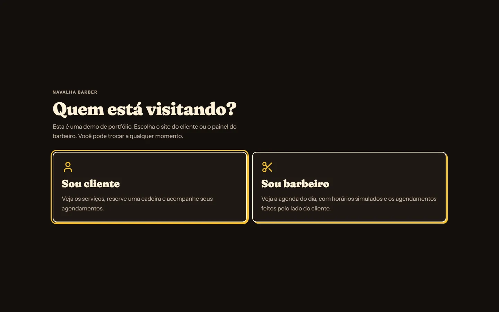

<div align="center">

# Navalha Barber

**A classic barbershop demo, in Portuguese and English.**
Clients book a chair. Barbers see their day.

[](https://barber-shop-portfolio-weld.vercel.app/)




</div>

> **Portfolio project.** The shop is fictional. Names, prices, reviews and photos are sample content, and no real payment is ever made.

## Highlights

- **Two entry points:** a client experience and a barber experience.
- **Online booking** with per-barber availability and time slots.
- **Monthly plans** (hair, beard, or both) with a simulated checkout.
- **Barber schedule** showing the day's appointments, including the bookings made on the client side.
- **Bilingual:** Brazilian Portuguese and English with a language switcher (`next-intl`).
- **Warm vintage design:** cream and brown palette, strong serif headings, map of the shop.
- **Tested pricing logic** with Vitest.

## Tech stack

| Area | Choice |
|---|---|
| Framework | Next.js 16 (App Router) |
| Language | TypeScript |
| Styling | Tailwind CSS 4 |
| i18n | next-intl (`pt-BR`, `en`) |
| Map and icons | Leaflet, lucide-react |
| Tests | Vitest |

## Getting started

```bash
npm install
npm run dev        # http://localhost:3000
```

No environment variables are required to run the demo. [`.env.example`](.env.example) lists nothing secret.

| Command | What it does |
|---|---|
| `npm run dev` | Start the dev server |
| `npm run build` | Production build |
| `npm run start` | Serve the production build |
| `npm run lint` | Run ESLint |
| `npm run typecheck` | Type-check with TypeScript |
| `npm test` | Run the Vitest suite |

## Project structure

```
messages/       Translations: en.json, pt-BR.json
src/
  app/          [locale] pages (home, barber, checkout) and checkout API routes
  components/   Booking flow, checkout, sections, map, role gate
  lib/          Schedule, team, brand and checkout logic (with tests)
  i18n/         next-intl setup
```

Design rules live in [`DESIGN.md`](DESIGN.md) and the scope in [`BRIEF.md`](BRIEF.md).

## Author

Built by **Eduardo Sousa**, web developer in Belo Horizonte, Brazil.

[Portfolio](https://oeduardosousa.com) · [LinkedIn](https://www.linkedin.com/in/eduardo-sousa-528b77334) · [GitHub](https://github.com/oeduardosousa)
